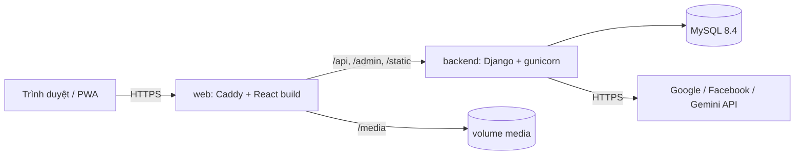
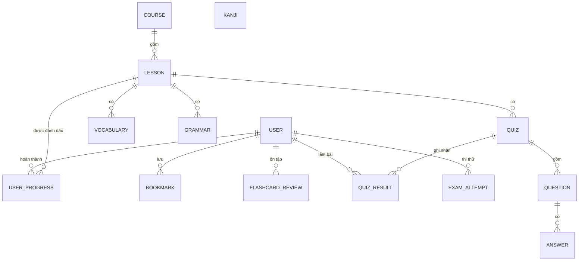

<div align="center">

# 日本語 Hikari — Japanese Learning Platform

**Nền tảng học tiếng Nhật theo lộ trình JLPT N5 → N1**

Từ vựng · Kanji · Ngữ pháp · Flashcard lặp lại ngắt quãng (SRS) · Thi thử có bấm giờ · Trợ lý AI


[Tính năng](#tính-năng) · [Kiến trúc](#kiến-trúc) · [Bắt đầu nhanh](#bắt-đầu-nhanh-với-docker) · [Tài liệu API](#tài-liệu-api) · [Triển khai](#triển-khai)

</div>

---

## Giới thiệu

**Hikari** là ứng dụng web giúp người Việt học tiếng Nhật có hệ thống, từ bảng chữ cái đến luyện thi JLPT. Nội dung được tổ chức theo cấp độ **N5 → N1**, kết hợp học lý thuyết (khoá học, bài học, ngữ pháp), tra cứu (từ vựng, Kanji có hoạt hình thứ tự nét) và ôn tập bằng thuật toán **lặp lại ngắt quãng SM-2** để ghi nhớ lâu dài.

Dự án gồm REST API viết bằng Django REST Framework, giao diện React dạng SPA có thể cài như ứng dụng (PWA), được đóng gói bằng Docker và kiểm tra tự động bằng GitHub Actions.

<!-- Bỏ dấu chú thích ở dòng dưới khi đã có link demo
**Demo trực tuyến:** https://ten-mien-cua-ban.com
-->

### Ảnh chụp màn hình

| Dashboard | Flashcard SRS |
|---|---|
|  |  |

| Thứ tự nét Kanji | Thi thử có bấm giờ |
|---|---|
|  |  |

| Trợ lý AI | Tài liệu API (Swagger) |
|---|---|
|  |  |

## Tính năng

### Nội dung học
- **Lộ trình N5 → N1:** khoá học → bài học; mỗi bài gồm từ vựng, ngữ pháp và bài kiểm tra. Đánh dấu hoàn thành bài và xem % tiến độ từng khoá.
- **Kho từ vựng & Kanji:** tìm kiếm theo Kanji / Kana / Romaji / nghĩa, lọc theo cấp độ, phân trang phía server, lưu từ yêu thích.
- **Hoạt hình thứ tự nét Kanji:** vẽ từng nét, tạm dừng, lùi/tiến từng nét, đổi tốc độ, hiện số nét (dữ liệu KanjiVG).
- **Ngữ pháp JLPT:** mẫu câu, giải thích, câu ví dụ có phát âm.
- **Bảng chữ cái:** Hiragana, Katakana, âm ghép, trường âm, âm ngắt; bấm để nghe.
- **Phát âm tiếng Nhật:** tự chọn giọng đọc tiếng Nhật tốt nhất của thiết bị (Web Speech API), làm sạch văn bản trước khi đọc.

### Ôn tập & kiểm tra
- **Flashcard SRS (SM-2):** hàng đợi gồm từ đến hạn ôn trước, từ mới sau, theo cấp độ từ thấp đến cao. Câu hỏi trắc nghiệm 4 đáp án, trả lời sai thì học lại ngay trong lượt, mục **Đã ôn** có phân trang (ôn sớm chỉ luyện thêm, không đổi lịch).
- **Quiz theo bài:** chấm điểm ở server (đáp án đúng không gửi xuống trình duyệt), lịch sử làm bài.
- **Thi thử có bấm giờ:** đề trắc nghiệm tự sinh từ kho dữ liệu (từ vựng, Hán tự, ngữ pháp, câu tuyển chọn); server giữ đồng hồ và chấm điểm; tải lại trang vẫn làm tiếp đúng thời gian còn lại; xem lại đáp án kèm giải thích.

### Động lực học
- **Điểm, chuỗi ngày học (streak) và bảng xếp hạng.**
- **Dashboard cá nhân:** số từ cần ôn hôm nay, bài học tiếp theo, tiến độ theo cấp độ và theo khoá, bài kiểm tra gần đây.

### Trợ lý AI "Sensei AI"
- Chat hỏi đáp tiếng Nhật (ngữ pháp, từ vựng, sửa câu) dùng **Google Gemini**, hiển thị dạng nút nổi ở mọi trang.
- Khoá API chỉ nằm ở server, có giới hạn tần suất theo người dùng, giới hạn độ dài và số tin nhắn.

### Tài khoản & bảo mật
- Đăng ký / đăng nhập bằng **JWT** (access + refresh, tự động làm mới token khi hết hạn).
- Đăng nhập bằng **Google** và **Facebook** (server xác minh token trước khi cấp phiên).
- Đổi thông tin tài khoản, đổi mật khẩu (ẩn với tài khoản mạng xã hội không có mật khẩu).

### Trải nghiệm & vận hành
- **PWA:** cài như ứng dụng, thông báo khi có phiên bản mới, báo khi mất mạng, lưu sẵn dữ liệu thứ tự nét đã xem.
- **Django Admin** để quản lý toàn bộ nội dung học.
- **Seed dữ liệu theo cấp độ** từ file JSON, chạy lại bao nhiêu lần cũng không mất dữ liệu người dùng.
- **Docker Compose** một lệnh chạy cả hệ thống, **GitHub Actions** kiểm tra tự động.

## Công nghệ sử dụng

| Lớp | Công nghệ |
|---|---|
| Backend | Python 3.11, Django 5.2, Django REST Framework, SimpleJWT, drf-spectacular, django-cors-headers |
| Cơ sở dữ liệu | MySQL 8.4 |
| Frontend | React, Vite, React Router, Axios, Tailwind CSS v4, lucide-react |
| Xác thực xã hội | Google Identity Services, Facebook Login |
| AI | Google Gemini API (`google-genai`) |
| PWA | vite-plugin-pwa (Workbox) |
| Hạ tầng | Docker Compose, Caddy (HTTPS tự động), gunicorn, WhiteNoise |
| CI | GitHub Actions |

## Kiến trúc



Web và API dùng chung **một địa chỉ**, nên không phát sinh CORS ở môi trường thật. Chỉ container `web` mở cổng ra ngoài, backend và MySQL nằm trong mạng nội bộ của Docker.

### Mô hình dữ liệu (rút gọn)


`Bookmark` và `FlashcardReview` tham chiếu từ vựng hoặc Kanji bằng cặp `content_type` + `object_id`.

### Cấu trúc thư mục

```
japanese-learning-platform/
├── .github/workflows/ci.yml      # CI: kiểm tra backend + build frontend
├── backend/
│   ├── api/
│   │   ├── models/               # Mô hình dữ liệu (tách theo chức năng)
│   │   ├── serializers/
│   │   ├── views/
│   │   ├── services/             # SM-2, tạo đề thi, chấm điểm, dashboard, gamification, Gemini...
│   │   ├── management/commands/  # seed_data, build_kanji_strokes
│   │   └── seed/                 # n5.json ... n1.json
│   ├── core/                     # settings, urls, wsgi
│   ├── Dockerfile
│   └── entrypoint.sh
├── frontend/
│   ├── public/                   # biểu tượng PWA, dữ liệu thứ tự nét (kanjivg)
│   └── src/                      # pages, components, context, api, hooks, utils, data
├── deploy/                       # Caddyfile, web.Dockerfile
├── docker-compose.yml
└── .env.example
```

## Bắt đầu nhanh với Docker

Cần cài sẵn [Docker](https://www.docker.com/products/docker-desktop/) (có Docker Compose).

```bash
git clone https://github.com/HongPhuc2511/japanese-learning-platform.git
cd japanese-learning-platform

cp .env.example .env        # Windows: copy .env.example .env
# Mở file .env và điền SECRET_KEY, mật khẩu cơ sở dữ liệu, các khoá API (xem bảng bên dưới)

docker compose up --build
```

Mở terminal thứ hai để tạo tài khoản quản trị và nạp dữ liệu:

```bash
docker compose exec backend python manage.py createsuperuser
docker compose exec backend python manage.py seed_data
```

| Địa chỉ | Nội dung |
|---|---|
| http://localhost | Ứng dụng |
| http://localhost/admin/ | Trang quản trị |
| http://localhost/api/docs/ | Tài liệu API (Swagger) |

> Các khoá Gemini, Google và Facebook là tuỳ chọn. Bỏ trống thì các chức năng tương ứng (trợ lý AI, đăng nhập mạng xã hội) không dùng được, phần còn lại vẫn chạy bình thường.

## Chạy môi trường phát triển (không dùng Docker)

**Backend** (cần Python 3.11 và một MySQL đang chạy):

```bash
cd backend
python -m venv .venv
.venv\Scripts\activate            # macOS/Linux: source .venv/bin/activate
pip install -r requirements.txt
```

Tạo file `backend/.env`:

```env
SECRET_KEY=doi-thanh-chuoi-bi-mat-cua-ban
DB_HOST=127.0.0.1
DB_PORT=3306
DB_NAME=hikari
DB_USER=root
DB_PASSWORD=mat-khau-mysql
GEMINI_API_KEY=
GOOGLE_CLIENT_ID=
FACEBOOK_APP_ID=
FACEBOOK_APP_SECRET=
```

```bash
python manage.py migrate
python manage.py createsuperuser
python manage.py seed_data
python manage.py runserver
```
API chạy tại `http://127.0.0.1:8000`, tài liệu tại `http://127.0.0.1:8000/api/docs/`.

**Frontend** (cần Node.js 20):

```bash
cd frontend
npm install
```

Tạo file `frontend/.env`:

```env
VITE_BASE_URL=http://127.0.0.1:8000/
VITE_GOOGLE_CLIENT_ID=
VITE_FACEBOOK_APP_ID=
```

```bash
npm run dev
```
Mở `https://localhost:5173`. Server phát triển dùng chứng chỉ tự ký (cần thiết vì đăng nhập Facebook bắt buộc HTTPS), trình duyệt sẽ cảnh báo ở lần đầu, hãy chọn tiếp tục truy cập.

## Biến môi trường

### Docker Compose (file `.env` ở thư mục gốc)

| Biến | Ý nghĩa | Bắt buộc |
|---|---|---|
| `DOMAIN` | Địa chỉ web. Chạy thử: `:80`. Máy chủ thật: tên miền, Caddy tự xin chứng chỉ HTTPS | Có |
| `PUBLIC_URL` | Địa chỉ đầy đủ, ví dụ `http://localhost` hoặc `https://ten-mien.com` | Có |
| `ALLOWED_HOSTS` | Danh sách host được phép, cách nhau bằng dấu phẩy | Có |
| `HTTPS_ONLY` | `True` trên máy chủ thật (bật cookie bảo mật) | Không |
| `TIME_ZONE` | Múi giờ, mặc định `Asia/Ho_Chi_Minh` | Không |
| `SECRET_KEY` | Khoá bí mật của Django | Có |
| `DB_NAME`, `DB_USER`, `DB_PASSWORD`, `DB_ROOT_PASSWORD` | Thông tin MySQL | Có |
| `GEMINI_API_KEY`, `ASSISTANT_MODEL` | Trợ lý AI và tên mô hình | Không |
| `GOOGLE_CLIENT_ID` | Đăng nhập Google | Không |
| `FACEBOOK_APP_ID`, `FACEBOOK_APP_SECRET` | Đăng nhập Facebook | Không |

### Frontend (`frontend/.env`, khi chạy ngoài Docker)

| Biến | Ý nghĩa |
|---|---|
| `VITE_BASE_URL` | Địa chỉ API backend |
| `VITE_GOOGLE_CLIENT_ID` | Client ID của Google (công khai) |
| `VITE_FACEBOOK_APP_ID` | App ID của Facebook (công khai) |

Chỉ đặt ID công khai trong biến `VITE_*`, vì chúng được nhúng vào mã JavaScript gửi tới trình duyệt. Các khoá bí mật chỉ nằm ở backend.

## Tài liệu API

Toàn bộ API được mô tả bằng **OpenAPI**, xem và thử trực tiếp tại **Swagger UI**:

- Chạy local: http://127.0.0.1:8000/api/docs/
- Chạy bằng Docker: http://localhost/api/docs/
- Schema thô: `/api/schema/`

Các API cần đăng nhập gửi kèm header `Authorization: Bearer <access_token>`. Lấy token từ `POST /api/auth/login/`, trong Swagger bấm **Authorize** và nhập `Bearer <access_token>`.

| Nhóm | Endpoint chính |
|---|---|
| Xác thực | `auth/register/`, `auth/login/`, `auth/refresh/`, `auth/me/`, `auth/change-password/`, `auth/google/`, `auth/facebook/` |
| Nội dung học | `courses/`, `lessons/`, `vocabulary/`, `kanji/`, `grammar/` (hỗ trợ `?level=`, `?search=`, `?page=`) |
| Quiz | `quizzes/`, `quizzes/{id}/submit/`, `quiz-results/` |
| Tiến độ | `progress/`, `bookmarks/` |
| Flashcard SRS | `flashcards/queue/`, `flashcards/answer/`, `flashcards/reviewed/`, `flashcards/due/` |
| Thi thử | `exams/`, `exams/active/`, `exams/{id}/`, `exams/{id}/submit/` |
| Tổng hợp | `dashboard/`, `leaderboard/` |
| Trợ lý AI | `assistant/chat/` |

## Dữ liệu và lệnh quản trị

| Lệnh | Tác dụng |
|---|---|
| `python manage.py seed_data` | Nạp nội dung N5 → N1 từ `backend/api/seed/*.json`, chạy lại an toàn, không xoá dữ liệu người dùng |
| `python manage.py seed_data --level N5 N4` | Chỉ nạp các cấp độ được chọn |
| `python manage.py seed_data --reset` | Xoá nội dung của các cấp được chọn trước khi nạp (kéo theo tiến độ gắn với các bài đó) |
| `python manage.py seed_data --flashcards <username>` | Tạo thẻ ôn tập cho một người dùng |
| `python manage.py build_kanji_strokes <kanjivg.zip>` | Tạo dữ liệu thứ tự nét cho các Kanji trong cơ sở dữ liệu |

Mỗi file seed theo cấu trúc `courses → lessons → vocabulary / grammar / quizzes` cộng danh sách `kanji`, cấp độ lấy từ tên file.

### Cách tính điểm

| Hành động | Điểm |
|---|---|
| Hoàn thành một bài học (lần đầu) | +10 |
| Mỗi câu quiz đúng | +5 |
| Trả lời đúng một thẻ ôn tập đến hạn hoặc từ mới | +2 |
| Mỗi câu đúng trong bài thi thử (nộp đúng hạn) | +1 |

Mọi hành động học đều giữ chuỗi ngày học. Ôn sớm một thẻ chưa đến hạn không cộng điểm.

## CI/CD và quy trình phát triển

**CI** (`.github/workflows/ci.yml`) chạy mỗi lần push hoặc mở Pull Request vào `main`:

- **Backend:** cài thư viện, `manage.py check`, và kiểm tra không thiếu migration (`makemigrations --check --dry-run`).
- **Frontend:** cài thư viện và `npm run build`.

**Quy trình làm việc:**

1. Tạo **Issue** mô tả chức năng.
2. Tạo nhánh `feature/<tên>` (hoặc `fix/<tên>`) từ `main`.
3. Commit theo quy ước `feat:`, `fix:`, `chore:`, `style:`.
4. Mở **Pull Request**, đợi CI xanh rồi merge và xoá nhánh.

## Triển khai

Hệ thống được thiết kế để chạy trên một máy chủ Linux có Docker:

```bash
git clone https://github.com/HongPhuc2511/japanese-learning-platform.git
cd japanese-learning-platform
cp .env.example .env     # đặt DOMAIN, PUBLIC_URL, ALLOWED_HOSTS, HTTPS_ONLY=True và các bí mật mới

docker compose up -d --build
docker compose exec backend python manage.py createsuperuser
docker compose exec backend python manage.py seed_data
```

Trỏ bản ghi DNS `A` của tên miền về IP máy chủ và mở cổng 80, 443: Caddy tự xin và gia hạn chứng chỉ HTTPS. Cập nhật phiên bản mới:

```bash
git pull && docker compose up -d --build
```

Sao lưu cơ sở dữ liệu:

```bash
docker compose exec -T db sh -c 'mysqldump -u"$MYSQL_USER" -p"$MYSQL_PASSWORD" "$MYSQL_DATABASE"' > backup.sql
```

## Bảo mật

- Bí mật (khoá API, mật khẩu, `SECRET_KEY`) chỉ nằm trong biến môi trường, `.env` đã được loại khỏi Git và khỏi image Docker.
- Token Google và Facebook được **xác minh ở server** trước khi cấp phiên; token Facebook phải thuộc đúng ứng dụng của dự án.
- Đáp án quiz và đề thi được **chấm ở server**, đáp án đúng không gửi xuống trình duyệt khi đang làm bài; đồng hồ thi thử do server tính.
- API trợ lý AI yêu cầu đăng nhập và có giới hạn tần suất để bảo vệ hạn mức của khoá API.
- Ứng dụng chạy bằng tài khoản không có quyền root trong container; cơ sở dữ liệu không mở cổng ra ngoài.

## Hạn chế đã biết

- Đăng nhập Facebook và Google đang ở chế độ phát triển/thử nghiệm: chỉ tài khoản được thêm làm Tester (Facebook) hoặc Test user (Google) mới đăng nhập được. Mở công khai cần hoàn tất thủ tục xác minh của từng nền tảng.
- Bài thi thử chưa có phần nghe và đọc hiểu, đề là bài trắc nghiệm tự sinh để luyện tập, không phải đề thi chính thức.
- Chưa có bộ kiểm thử tự động cho API.

## Lộ trình

- [ ] Viết unit test và integration test cho các luồng chính (xác thực, quiz, SRS, thi thử)
- [ ] Thêm phần đọc hiểu và nghe vào bài thi thử
- [ ] Tự động triển khai (CD) bằng GitHub Actions
- [ ] Sao lưu tự động và giám sát hệ thống
- [ ] Bảng xếp hạng theo tuần, biểu đồ hoạt động theo ngày, huy hiệu thành tích

## Ghi nguồn và giấy phép

- Dữ liệu thứ tự nét Kanji: **[KanjiVG](https://kanjivg.tagaini.net/)** © Ulrich Apel, theo giấy phép [Creative Commons Attribution-Share Alike 3.0](https://creativecommons.org/licenses/by-sa/3.0/). Các file trong `frontend/public/kanjivg/` là dữ liệu dẫn xuất và giữ nguyên giấy phép này.
- Biểu tượng: [Lucide](https://lucide.dev/). Phông chữ: Google Fonts.
- Mã nguồn dự án phát hành theo giấy phép **MIT**, xem file [`LICENSE`](LICENSE).

## Tác giả

Phát triển bởi **Phúc** · [@HongPhuc2511](https://github.com/HongPhuc2511)

Góp ý và báo lỗi: mở [Issue](https://github.com/HongPhuc2511/japanese-learning-platform/issues) trên GitHub.
